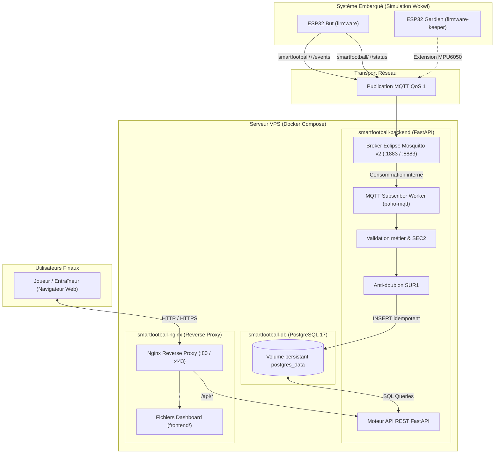

# Documentation Cloud & Données (Étapes 5, 6, 7)

**Auteur** : Alae (Cloud & Données)  
**Projet** : Smart Football (ESI 5e année, Cybersécurité & Systèmes Embarqués)  
**Dernière mise à jour** : 25 novembre 2026

---

## 1. Vue d'ensemble de l'architecture

Le sous-système cloud et données prend en charge l'ensemble du cycle de vie de la donnée sportive, depuis sa réception broker jusqu'à sa restitution analytique sur le tableau de bord :
1. **Ingestion MQTT temps réel** : écoute sécurisée en QoS 1 des tirs et heartbeats émis par l'ESP32.
2. **Contrôle et validation stricte** : conformité au cahier des charges et respect des exigences de sécurité (plage de vitesse SEC2, zones autorisées, valeurs ADC brutes).
3. **Persistance sans doublon (SUR1)** : stockage relationnel PostgreSQL sur volume persistant avec garantie d'idempotence.
4. **Calcul de latence (ENF1)** : mesure millimétrique de l'écart temporel entre l'émission et l'ingestion serveur.
5. **API REST structurée** : exposition des données, des agrégats statistiques et de la comparaison de séances.
6. **Tableau de bord web (Étape 6)** : visualisation interactive (heatmap de but, KPIs, graphiques comparatifs, état du gardien).
7. **Déploiement VPS sécurisé (Étape 7)** : reverse-proxy Nginx, isolation réseau Docker et intégration avec le pare-feu UFW.



---

## 2. Étape 5 : Mosquitto, FastAPI & PostgreSQL

### 2.1 Configuration Docker Compose (`infra/compose.yaml`)
L'infrastructure est déployée via Docker Compose sous un réseau applicatif isolé (`smartfootball_net`) :
- **`db`** : PostgreSQL 17 Alpine. Le service est nommé `db` pour être directement interopérable avec le script de sauvegarde `infra/security/backup-postgres.sh`. Son port n'est exposé que sur l'interface locale `127.0.0.1:5432` pour empêcher tout accès externe non filtré par le pare-feu UFW.
- **`mosquitto`** : Broker Eclipse Mosquitto v2 configuré dans `infra/mosquitto/mosquitto.conf`. Écoute sur le port 1883 (simulation Wokwi) et pré-configuré pour l'ajout du chiffrement TLS sur le port 8883 à l'étape 8a par Mohamed.
- **`backend`** : Service FastAPI (Python 3.11/3.14). Intègre un thread d'écoute MQTT asynchrone démarré lors de l'évènement de cycle de vie `lifespan`.
- **`nginx`** : Point d'entrée unique HTTP/HTTPS distribuant les pages du tableau de bord et transférant les appels d'API vers le backend.

### 2.2 Schéma relationnel de la base de données (`shots` & `device_status`)
Le modèle de données garantit l'intégrité référentielle, la rapidité des recherches chronologiques et l'idempotence des réceptions :

#### Table `shots` :
```sql
CREATE TABLE shots (
    id SERIAL PRIMARY KEY,
    event_id VARCHAR(64) UNIQUE NOT NULL,      -- Contrainte d'unicité SUR1
    device_id VARCHAR(64) NOT NULL,
    session_id VARCHAR(64) NOT NULL,
    event_type VARCHAR(32) DEFAULT 'shot' NOT NULL,
    timestamp TIMESTAMPTZ NOT NULL,            -- Horodatage émis par l'ESP32
    ball_speed_kmh FLOAT NOT NULL,             -- Vitesse validée [5.0, 150.0] km/h
    pressure_reading INTEGER NOT NULL,         -- Valeur ADC brute FSR [0, 4095]
    target_zone VARCHAR(32) NOT NULL,          -- Zone touchée ou 'none'
    impact_intensity INTEGER NOT NULL,         -- Valeur ADC brute piézo [0, 4095]
    firmware_version VARCHAR(32) NOT NULL,
    received_at TIMESTAMPTZ NOT NULL DEFAULT NOW() -- Horodatage serveur pour ENF1
);

CREATE INDEX idx_shots_session_timestamp ON shots (session_id, timestamp);
CREATE INDEX idx_shots_device_timestamp ON shots (device_id, timestamp);
```

#### Table `device_status` :
Consigne les battements de cœur périodiques (heartbeats à 30 s), les signalements d'erreurs (vitesse rejetée, capteur défaillant) et les messages de dernière volonté (*Last Will and Testament*) :
```sql
CREATE TABLE device_status (
    id SERIAL PRIMARY KEY,
    device_id VARCHAR(64) NOT NULL,
    status VARCHAR(32) NOT NULL,               -- 'heartbeat', 'error', 'offline', 'online'
    firmware_version VARCHAR(32),
    uptime_seconds INTEGER,
    payload TEXT,
    timestamp TIMESTAMPTZ,
    received_at TIMESTAMPTZ NOT NULL DEFAULT NOW()
);
```

### 2.3 Règles de validation et sécurité des messages MQTT
Chaque payload reçu sur `smartfootball/<device_id>/events` est analysé avant toute persistance :
1. **Intégrité syntaxique** : Présence des 10 champs obligatoires du cahier des charges (`event_id`, `device_id`, `session_id`, `event_type`, `timestamp`, `ball_speed_kmh`, `pressure_reading`, `target_zone`, `impact_intensity`, `firmware_version`).
2. **Contrôle de vitesse (Exigence SEC2)** :
   $$\text{Vitesse valide} \in [5.0, 150.0] \text{ km/h}$$
   Tout tir mesuré en dehors de cet intervalle est systématiquement rejeté par le validateur `app.validation.validate_shot_payload()`. Aucun enregistrement n'est inséré en base et un log d'avertissement de sécurité est consigné.
3. **Zones cibles admissibles** :
   - Prototype 4 zones : `upper_left`, `upper_right`, `lower_left`, `lower_right`.
   - Tir non cadré ou sans impact : `none`.
   - Compatibilité extension 9 zones sans modification de code ni de schéma : `center`, `upper_center`, `lower_center`, `middle_left`, `middle_right`.
4. **Valeurs ADC brutes (non Newtons)** :
   `pressure_reading` et `impact_intensity` sont des entiers positifs $\ge 0$ (lectures brutes ADC [0-4095]). Aucune conversion fictive en Newtons n'est effectuée.

### 2.4 Mécanisme anti-doublon et résilience (Exigence SUR1)
- L'`event_id` (UUIDv4) généré à l'impact par l'ESP32 est configuré avec une contrainte d'unicité `UNIQUE` dans la table `shots`.
- La fonction `app.services.record_shot()` intercepte les collisions d'identifiant et renvoie le statut `duplicate_ignored`.
- **Preuve SUR1** : En cas de coupure de liaison entre le but et le broker, l'ESP32 conserve jusqu'à 20 tirs dans sa mémoire tampon locale. Lors du rétablissement de la communication, la réémission intégrale de la rafale est ingérée sans générer la moindre ligne dupliquée en base.

### 2.5 Mesure de la latence de bout en bout (Exigence ENF1)
- Lors de l'insertion d'un tir, le serveur applique son propre horodatage UTC millimétrique `received_at`.
- L'écart temporel est calculé à la restitution :
  $$\Delta t = |\text{received\_at} - \text{timestamp}|$$
- Cet écart est exposé dans le champ `latency_ms` de l'API. L'exigence ENF1 impose $\Delta t < 2.0\text{ s}$ en conditions normales.

---

## 3. Étape 6 : Tableau de bord télémétrique

L'interface web (`frontend/`) est conçue en HTML5, CSS3 moderne et JavaScript natif (ES6+), sans dépendance Node.js ni étape de compilation, assurant des performances maximales sur le serveur VPS.

### 3.1 Indicateurs clés de performance (KPIs)
- **Total de tirs** : Nombre total d'évènements enregistrés dans la sélection.
- **Taux de précision (%)** :
  $$\text{Taux de précision} = \frac{\text{Tirs cadrés}}{\text{Total des tirs}} \times 100$$
  avec : $\text{Tirs cadrés} = \text{Total} - \text{Tirs avec } \texttt{target\_zone} = \text{"none"}$.
- **Vitesse moyenne et maximale** : Statistiques calculées sur les barrières optiques infrarouges (km/h).
- **Pression relative moyenne FSR** : Moyenne arithmétique des valeurs ADC brutes.
- **Intensité relative moyenne d'impact** : Moyenne arithmétique des valeurs ADC brutes des piézos.

### 3.2 Représentation visuelle du but & Heatmap
- **Cadre interactif** : Visualisation schématique des 4 quadrants (`upper_left`, `upper_right`, `lower_left`, `lower_right`).
- **Zone Hors Cadre** : Affichage différencié pour les frappes n'ayant percuté aucun capteur piézoélectrique (`none`).
- **Bascule 9 zones** : Bouton permettant d'afficher la grille étendue à 9 zones.
- **Intensité dynamique** : Chaque quadrant module sa coloration et son opacité en temps réel selon la part relative de tirs reçus.

### 3.3 Transparence et qualification de la donnée
Pour respecter les directives pédagogiques et méthodologiques du projet, l'interface affiche une légende permanente :
- 🟢 **Mesure réelle** : Vitesse déterminée par les barrières IR ($v = D / \Delta t$) et zone d'impact des piézos.
- 🟡 **Valeur brute ADC relative** : Pression FSR et intensité piézo (exprimées en unités ADC relatives [0-4095], jamais en Newtons).
- 🔵 **Données de démonstration** : Tirs générés depuis la simulation Wokwi ou via le script de test.

### 3.4 Comparaison de séances d'entraînement
Le panneau comparatif permet de sélectionner deux séances distinctes et d'analyser l'évolution des performances :
- Écart de volume de frappes.
- Progression du taux de précision cadrée (+/- %).
- Évolution de la vitesse moyenne et de pointe.
- Analyse différentielle de l'engagement physique (pression FSR).

### 3.5 Extension Gardien (`keeper-esp32-01`)
Une carte de supervision dédiée permet de visualiser l'état du module embarqué du gardien équipé de la centrale inertielle MPU6050 (connexion, dernier battement de cœur).

---

## 4. Étape 7 : Déploiement VPS & Scripts d'injection

Le déploiement sur VPS Ubuntu permet à la simulation Wokwi d'atteindre le broker Mosquitto via son adresse IP publique.

### 4.1 Architecture du Reverse Proxy Nginx (`infra/nginx/nginx.conf`)
- Port 80 (et 443 pour HTTPS) exposé sur le serveur hôte.
- Redirection transparente des routes :
  - `GET /` $\rightarrow$ Fichiers statiques du tableau de bord (`frontend/`).
  - `ANY /api/*` $\rightarrow$ Transféré vers `http://backend:8000/api/*`.
  - `GET /health` $\rightarrow$ Transféré vers `http://backend:8000/health`.

### 4.2 Script de test et simulation (`scripts/simulate_shots.py`)
Un outil en ligne de commande complet permet de tester et valider l'ensemble des scénarios :
- **Publication unitaire** :
  ```bash
  python3 scripts/simulate_shots.py --mode single --api http://localhost
  ```
- **Validation du mécanisme anti-doublon SUR1 (rafale de 10 tirs dupliqués)** :
  ```bash
  python3 scripts/simulate_shots.py --mode sur1-test --api http://localhost
  ```
- **Validation du rejet de vitesse hors plage SEC2** :
  ```bash
  python3 scripts/simulate_shots.py --mode sec2-test --api http://localhost
  ```
- **Alimentation d'une séance complète de démonstration** :
  ```bash
  python3 scripts/simulate_shots.py --mode seed-demo --session session-demo --api http://localhost
  ```

---

## 5. Matrice de traçabilité des exigences

| Exigence | Intitulé | Rôle d'Alae (Cloud & Données) | Méthode de validation | Statut |
|---|---|---|---|---|
| **SEC2** | Rejet des vitesses hors [5, 150] km/h | Validateur Pydantic + interdiction d'écriture en base | Tests unitaires `test_validation.py` + `simulate_shots.py --mode sec2-test` | ✅ Validé (53 tests) |
| **SUR1** | Persistance sans doublon après coupure | Clé unique `event_id` sur la table `shots` + insertion idempotente | Tests unitaires `test_deduplication.py` + `simulate_shots.py --mode sur1-test` | ✅ Validé |
| **ENF1** | Latence de réception < 2.0 s | Horodatage `received_at` à la milliseconde + exposition de `latency_ms` | Calcul automatique dans l'API REST et affichage sur le tableau de bord | ✅ Validé |

---

## 6. Synthèse des tests automatisés (`backend/tests/`)

La totalité de la suite de tests est exécutable via la commande standard :
```bash
pytest backend/tests/ -v
```

**Bilan d'exécution : 53 tests passés avec succès (100%)**
- `test_validation.py` (26 tests) : Validation des vitesses limites (5.0 km/h, 150.0 km/h), rejet des valeurs hors limites (<5 ou >150), validation des zones autorisées (4 zones, none, 9 zones), rejet des zones inconnues, contrôle des champs requis et des valeurs ADC brutes.
- `test_deduplication.py` (3 tests) : Création unitaire, rejet idempotent des doublons et validation spécifique du scénario SUR1 sur 10 tirs.
- `test_api.py` (9 tests) : Validation des routes `/health`, `POST /api/shots`, `GET /api/shots`, filtres, pagination, calcul de précision dans `/api/stats`, comparaison de séances `/api/stats/compare`, et liste d'appareils `/api/devices`.
- `test_mqtt.py` (4 tests) : Réception et ingestion d'évènements MQTT conformes, rejet de vitesse anormale sans écriture en base, gestion des messages dupliqués, et traitement des heartbeats/statuts.
