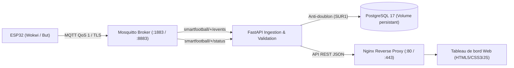

# Documentation Cloud & Données (Étapes 5, 6, 7)

Auteur : Alae (Cloud & Données)  
Contexte : Projet Smart Football (ESI 5e année, Cybersécurité & Systèmes Embarqués)

---

## 1. Vue d'ensemble de l'architecture

Le sous-système cloud et données assure l'ingestion temps réel des tirs mesurés par l'ESP32, la validation stricte des règles métier et de sécurité, le stockage persistant sans doublon, et la restitution visuelle sur le tableau de bord web.

---

## 2. Étape 5 : Mosquitto, FastAPI & PostgreSQL

### 2.1 Configuration Docker Compose (`infra/compose.yaml`)
- **`db`** : PostgreSQL 17 Alpine avec volume persistant `postgres_data`. Le service est nommé `db` pour être compatible avec le script de sauvegarde `infra/security/backup-postgres.sh`. Le port n'est exposé que sur `127.0.0.1:5432` pour respecter les règles de pare-feu UFW.
- **`mosquitto`** : Broker Eclipse Mosquitto v2 configuré dans `infra/mosquitto/mosquitto.conf`. Port local 1883 pour la simulation Wokwi, et préparé pour l'ajout du TLS sur le port 8883 par Mohamed (étape 8a).
- **`backend`** : Service FastAPI (Python 3.11) intégrant le client abonné MQTT (`paho-mqtt` v2) et les points d'accès REST.
- **`nginx`** : Serveur web et reverse-proxy routant le tableau de bord statique et les requêtes `/api/` vers FastAPI.

### 2.2 Validation des messages MQTT
Chaque message arrivant sur `smartfootball/<device_id>/events` est analysé avant toute écriture :
1. **Champs obligatoires** : `event_id`, `device_id`, `session_id`, `event_type`, `timestamp`, `ball_speed_kmh`, `pressure_reading`, `target_zone`, `impact_intensity`, `firmware_version`.
2. **Plage de vitesse (Exigence SEC2)** :
   $$\text{Vitesse valide} \in [5.0, 150.0] \text{ km/h}$$
   Tout tir hors plage est rejeté et consigné en journal d'alerte sécurité.
3. **Zones cibles** :
   Prototype à 4 zones : `upper_left`, `upper_right`, `lower_left`, `lower_right`, `none`.  
   Le schéma est conçu pour accepter sans rupture l'extension à 9 zones (`upper_center`, `lower_center`, `center`, `middle_left`, `middle_right`).
4. **Valeurs ADC brutes** :
   `pressure_reading` (capteur FSR) et `impact_intensity` (piézo) sont des entiers positifs représentant les valeurs brutes de l'ADC [0-4095], jamais converties artificiellement en Newtons.

### 2.3 Mécanisme anti-doublon (Exigence SUR1)
- L'`event_id` est défini comme clé unique dans la table `shots`.
- Lors de la réception d'un tir, le backend vérifie l'existence de l'`event_id`.
- Si un tir est renvoyé une seconde fois (par exemple après une reconnexion Wi-Fi de l'ESP32 ou un réacheminement MQTT QoS 1), la duplication est interceptée de manière idempotente : aucune seconde ligne n'est insérée.
- **Vérification SUR1** : une rafale de 10 tirs retransmise produit exactement 10 lignes en base.

### 2.4 Vérification de la latence de réception (Exigence ENF1)
- Le champ `received_at` horodate la réception serveur à la milliseconde près en UTC.
- L'écart temporel $\Delta t = |\text{received\_at} - \text{timestamp}|$ est calculé pour chaque tir et exposé via l'API REST (`latency_ms`).
- L'exigence ENF1 requiert $\Delta t < 2.0\text{ s}$.

---

## 3. Étape 6 : Tableau de bord

Le tableau de bord est situé dans `frontend/` (accessible sur `http://localhost/` via Nginx ou directement via l'application FastAPI) :
- **Indicateurs clés (KPIs)** :
  - Nombre total de tirs enregistrés.
  - Taux de précision (%) calculé selon la règle : $(\text{tirs cadrés} / \text{total}) \times 100$, où un tir hors cadre a `target_zone = "none"`.
  - Vitesse moyenne et vitesse maximale (km/h).
  - Pression relative moyenne FSR (valeur brute ADC).
  - Intensité relative moyenne piézo (valeur brute ADC).
- **Représentation interactive du but (Heatmap des zones)** :
  - Cadre de but dynamique affichant les 4 quadrants et leur concentration de tirs.
  - Affichage clair de la zone « Hors cadre / Tir sans impact (`none`) ».
  - Bouton de bascule vers le mode **9 zones** (extension).
- **Distinction explicite des données** :
  - 🟢 **Mesure réelle** : vitesse barrières IR, localisation piézo.
  - 🟡 **Valeur brute ADC relative** : pression relative FSR et intensité piézo (sans unité Newton).
  - 🔵 **Données de démonstration** : simulation Wokwi.
- **Outil de comparaison de séances** :
  - Sélection côte à côte de deux séances d'entraînement pour analyser l'évolution du joueur (tirs totaux, taux de précision, vitesse moyenne, pression).
- **Extension Gardien** :
  - Carte dédiée supervisant l'état du module gardien MPU6050 (`keeper-esp32-01`).

---

## 4. Résultats des tests unitaires (`backend/tests/`)

53 tests unitaires et d'intégration ont été exécutés avec succès (`pytest`) :
- **`test_validation.py`** : vérification des plages [5, 150] km/h (SEC2), des zones valides/invalides, des champs obligatoires et des types.
- **`test_deduplication.py`** : validation du comportement anti-doublon (SUR1) sur tir unique et rafales de 10 tirs.
- **`test_api.py`** : validation des points d'accès `/health`, `/api/shots`, `/api/stats`, `/api/sessions`, `/api/devices`.
- **`test_mqtt.py`** : validation du traitement des messages MQTT évènements et statut.
