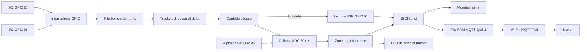

# Firmware ESP32 du but

## Objectif et état de validation

Le firmware mesure la vitesse d'un tir avec deux barrières IR, estime la zone
d'impact avec quatre capteurs piézo, lit la pression relative sur un FSR et
produit un événement JSON. Il peut ensuite transmettre les tirs par Wi-Fi et
MQTT/TLS. Le profil par défaut `esp32dev` reste hors ligne et sert à la
simulation locale.

La simulation Wokwi VS Code Community a validé manuellement les six scénarios
d'impact décrits dans [le banc Wokwi](wokwi-test/README.md). Les tests unitaires,
la compilation des profils firmware et la compilation des WASM sont décrits
ci-dessous. La communication MQTT/TLS avec un broker réel et Wokwi CI ne sont
pas validés de bout en bout. Les valeurs ADC restent brutes, non calibrées en
unités physiques.

## Architecture



Les interruptions ne font que dater et mettre en file les fronts descendants.
`loop()` vide la file, applique le tracker, prélève le FSR et échantillonne les
piézos. Le traitement réseau tourne dans sa propre tâche FreeRTOS; les fonctions
appelées par la boucle de mesure ne font pas d'attente réseau.

## Composants et broches

| Composant | Quantité | GPIO | Rôle |
|---|---:|---|---|
| ESP32 DevKit | 1 | — | Acquisition et traitement |
| IR Break Beam | 2 | 25, 26 | Mesure du temps et ordre de passage; sorties actives à LOW |
| `SYNC` IR | 1 liaison | beam1 ↔ beam2 | Déclenche IR2 après l'intervalle calculé par le maître |
| Piézo | 4 | 32, 33, 34, 35 | ADC1; zones upper-left, upper-right, lower-left, lower-right |
| FSR | 1 | 36 / VP | ADC1; pression relative |
| LED + résistance 220 Ω | 4 | 16–19 | Affichage de la zone gagnante |
| Buzzer | 1 | 23 | Signal sonore d'impact |

Les canaux ADC sont sur ADC1, disponible lorsque le Wi-Fi est activé. Les
broches de démarrage évitées sont 0, 2, 5, 12 et 15. Le câblage du circuit
principal est dans [diagram.json](diagram.json).

## Algorithmes de mesure

### Vitesse et direction

La distance entre les barrières est `BEAM_SPACING_M = 0.20 m`.

```text
delta_us = t(IR2) - t(IR1)
speed_kmh = 0.20 / (delta_us / 1 000 000) * 3.6
```

Un delta de 10 000 µs donne 72,0 km/h. Le tracker n'accepte que IR1 puis IR2;
IR2 puis IR1 produit un message d'erreur et aucun événement de tir. Le firmware
rejette les vitesses hors de 5 à 150 km/h, ignore les rebonds de moins de
1 000 µs, abandonne une mesure sans IR2 après 300 ms et réarme après le cycle
d'impact et un délai de 200 ms. Une file ISR pleine abandonne la mesure et
signale une erreur.

### ADC, zones et FSR

À la réception du second front d'un passage valide, le FSR est lu une fois sur
GPIO36. Cette valeur `pressure_reading` est brute (0–4095); elle n'est pas une
mesure en newtons.

Pendant 60 ms après IR2, `loop()` lit les quatre ADC piézo et conserve le pic de
chaque canal. `pick_zone()` retient les pics supérieurs ou égaux au seuil
`PIEZO_THRESHOLD_ADC = 300`; le plus élevé gagne, et le premier index gagne une
égalité. Les index 0–3 correspondent aux quatre zones du tableau ci-dessus. Si
aucun pic n'atteint le seuil, la zone vaut `none` et l'intensité 0. Les valeurs
`impact_intensity` sont également brutes et non calibrées en force.

Une zone gagnante allume sa LED et active le buzzer. Les actionneurs s'éteignent
après leur temporisation sans bloquer l'acquisition.

### JSON série

Chaque tir valide produit un JSON `event_type: "shot"` et un log `[SHOT]`.
Le log n'est pas un événement supplémentaire. Les erreurs et abandons peuvent
produire des JSON d'état séparés. Le format complet et les unités sont dans
[MQTT_INTEGRATION.md](MQTT_INTEGRATION.md).

## Wi-Fi, SNTP et MQTT/TLS

Le détail du contrat pour les équipes cloud, backend et sécurité est dans
[MQTT_INTEGRATION.md](MQTT_INTEGRATION.md). Résumé : profil `esp32net`, Wi-Fi
STA, synchronisation SNTP, ESP-MQTT sur TLS avec vérification du certificat CA
et du nom d'hôte, messages de tir QoS 1 et Last Will sur le topic status.

Le fichier local `include/secrets.h` doit être provisionné à partir de
`include/secrets.h.example`; il est ignoré par Git. Le profil réseau échoue
fermé sans configuration complète. Ne désactivez pas la validation TLS. Aucun
broker réel n'a été utilisé pour la validation de cette contribution.

Sans synchronisation SNTP, le profil hors ligne formate le temps de
fonctionnement comme une date Unix, ce qui produit des timestamps en 1970. En
réseau, les tirs en attente utilisent leur instant monotone de capture puis
attendent une heure SNTP valide avant publication.

## Custom Chips et deux simulations

Les puces de production sont `ir-break-beam`, `piezo-sensor` et `fsr-sensor`.
Leurs sources C et descriptions sont sous `../chips/`; leurs binaires WASM
chargés par le circuit principal sont versionnés dans `chips/`.

Deux projets Wokwi distincts sont disponibles :

1. **Circuit principal** — ouvrir `firmware/`, compiler `esp32dev`, puis lancer
   `Wokwi: Start Simulator`. Les deux puces IR et les quatre puces piézo restent
   séparées et connectées comme sur le circuit normal.
2. **Banc d'impacts** — compiler le firmware et les WASM du banc, puis ouvrir
   `firmware/wokwi-test/` comme dossier Wokwi autonome. Son séquenceur de test
   remplace les six sources IR/piézo afin de créer un tir à 72 km/h et un impact
   synchronisé. Les six scénarios et leurs résultats sont documentés dans
   [wokwi-test/README.md](wokwi-test/README.md).

Les scénarios YAML dans `scenarios/` sont automatisés par Wokwi CLI; ils
nécessitent un jeton CI et ne sont pas présentés comme validés. La validation
manuelle rapportée ici a été réalisée dans Wokwi VS Code Community.

## Organisation des fichiers

```text
firmware/
  include/          configuration GPIO, réseau et exemple de secrets
  src/              acquisition du but et tâche de communication réseau
  lib/shot_logic/   calcul vitesse, tracker, zones et JSON
  lib/delivery/     file RAM QoS 1 et projection temporelle
  test/             tests natifs de logique et de file
  chips/            WASM chargés par le circuit principal
  scenarios/        scénarios d'intégration Wokwi CLI
  scripts/          validation JSON et lanceur de scénarios CLI
  wokwi-test/       projet de test Wokwi VS Code indépendant
firmware-keeper/    projet distinct d'acquisition MPU6050
../chips/           sources C et tests WASM des custom chips
```

## Installation, compilation et tests

Prérequis : VS Code, PlatformIO Core, Node.js, Wokwi for VS Code Community et
clang/wasm-ld pour les custom chips. Sur Windows, le script du banc utilise le
clang WASM installé sous `C:\msys64\ucrt64\bin`.

Depuis la racine du dépôt, compiler les trois puces de production :

```sh
bash chips/build.sh
```

Compiler les puces locales du banc :

```powershell
powershell -ExecutionPolicy Bypass -File firmware/wokwi-test/build-chips.ps1
```

Depuis `firmware/` :

```sh
pio test -e native
pio run -e esp32dev -e esp32net -e esp32watchdog
```

Depuis la racine, lancer tous les tests Node/WASM :

```sh
node --test chips/tests/ir-break-beam.test.cjs chips/tests/piezo-sensor.test.cjs chips/tests/shot-sequencer.test.cjs firmware/wokwi-test/project.test.cjs firmware/scripts/check-shot.test.cjs
```

Le firmware du gardien est indépendant; ses commandes sont dans
[`../firmware-keeper/README.md`](../firmware-keeper/README.md). Les tests locaux
ne remplacent pas une validation interactive Wokwi ou un test MQTT/TLS avec le
broker de staging.

## Limites restantes

- Sept JSON de tir ont été observés sur l'ensemble des essais manuels de la
  table Wokwi; deux avaient la zone `none`. Les résultats par scénario sont
  conformes, mais les traces fournies ne permettent pas d'attribuer l'événement
  supplémentaire à une commande précise.
- Les valeurs ADC et le FSR ne sont pas calibrés en unités physiques.
- Les validations Wokwi CI, broker réel, TLS de bout en bout et matériel
  physique restent à effectuer.
- Le firmware gardien lit le MPU6050 mais ne publie pas de mouvement : le
  contrat backend/topic pour ces événements n'est pas défini.
